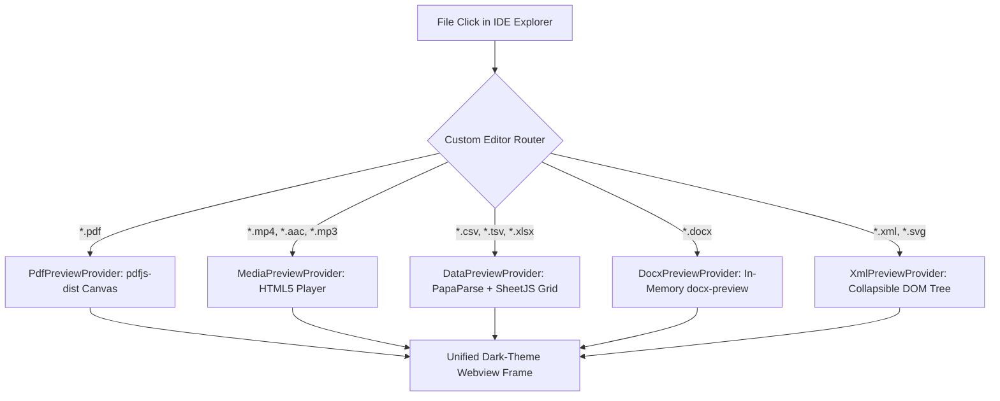

<div align="center">

# 🌌 OmniPreview

### *See Any File. Understand Any Format. Zero Encoding Jargon.*

**The Universal, Zero-Dependency File, PDF, Media Player & Spreadsheet Viewer Extension for VS Code, Google Antigravity 2.0 & Modern AI IDEs.**

[](https://github.com/Ayoola-tech2024/omnipreview)
[](LICENSE)
[](https://www.typescriptlang.org/)
[](https://github.com/Ayoola-tech2024/omnipreview)
[](https://github.com/Ayoola-tech2024/omnipreview/pulls)

<br/>

[✨ Features](#-key-features) • [⚡ Quick Install](#-quick-installation) • [🎯 Why OmniPreview](#-the-problem--why-omnipreview) • [📊 Supported Formats](#-supported-formats--engines) • [🏗️ Architecture](#-system-architecture)

---

</div>

## 💥 The Problem: Why Developers Need OmniPreview

Every developer working in VS Code or agentic setups like **Antigravity 2.0** or **Cursor** hits the exact same frustrating wall:

```
❌ The Text Editor Assumption:
Text editors assume ALL files are simple UTF-8 character strings.

❌ What Happens When You Click a PDF, Media File, or Word Doc:
The editor dumps raw compressed binary zlib streams directly onto your screen:
<</Filter/FlateDecode/Length 6890>> stream x]o8^>CHI"@^m...

❌ The Encoding Crash:
CSVs generated in Windows-1252 or with UTF-16 BOMs explode into broken characters () or misaligned columns.

❌ The Extension Bloat:
To fix this, developers are forced to install 6+ different bulky, abandoned extensions (one for PDF, one for Excel, one for audio, etc.) that slow down the IDE and clash with each other.
```

**OmniPreview solves this once and for all** with a single, ultra-fast 737 KB offline package that natively intercepts non-text file opens and spawns hardware-accelerated interactive webviews.

---

## ✨ Key Features

```
                                  ┌────────────────────────────────┐
                                  │      OmniPreview Engine        │
                                  └───────────────┬────────────────┘
                                                  │
                 ┌────────────────────────────────┼────────────────────────────────┐
                 ▼                                ▼                                ▼
  ┌──────────────────────────────┐ ┌──────────────────────────────┐ ┌──────────────────────────────┐
  │     Chrome-Style PDF.js      │ │     Rich Media Hub (4K)      │ │   Interactive Data Grid      │
  │ ──────────────────────────── │ │ ──────────────────────────── │ │ ──────────────────────────── │
  │ • Continuous vector scroll   │ │ • Native HTML5 Video & Audio │ │ • CSV, TSV, XLSX, XLS        │
  │ • Thumbnail sidebar & jump   │ │ • 0.5x - 2.0x speed presets  │ │ • Auto-detects UTF-8/1252    │
  │ • High-DPI canvas & zoom     │ │ • Waveforms & scrubbing bar  │ │ • Live search, sort & filter │
  │ • Rotate, select text, print │ │ • PiP, fullscreen & looping  │ │ • 1-Click CSV/JSON export    │
  └──────────────────────────────┘ └──────────────────────────────┘ └──────────────────────────────┘
```

### 1. 📄 Google Chrome-Identical PDF Viewer
- **High-DPI Canvas Rendering**: Vector-sharp page scaling powered by Mozilla `pdfjs-dist`.
- **Navigation & Jump**: Quick page jump (`Page [ 1 ] of 24`), previous/next hotkeys, and full-document continuous scrolling.
- **Thumbnail Sidebar**: 1-click collapsible page previews with live viewport sync.
- **Toolbar Actions**: Zoom in/out, fit-to-width (`↔`), 90° clockwise rotation (`↻`), text selection, and native print.

### 2. 🎬 High-Performance Media Player (Video & Audio)
- **Plays Real Video & Sound**: Seamless hardware-accelerated playback for `.mp4`, `.webm`, `.mov`, `.mp3`, `.aac`, `.wav`, `.ogg`, and `.flac`.
- **Playback Controls**: Interactive hover scrub bar, rewind/forward 5s, mute, volume slider, loop toggle, and Picture-in-Picture.
- **Variable Speed**: Switch on the fly between `0.5x`, `0.75x`, `1.0x (Normal)`, `1.25x`, `1.5x`, and `2.0x`.
- **Audio Waveform**: Glowing visual audio pulse analyzer for audio tracks.

### 3. 📊 Zero-Crash Data & Spreadsheet Matrix
- **Encoding Immunity**: Multi-tier byte inspection sniffs BOM and character sets (UTF-8, UTF-16, Windows-1252) so **zero mojibake characters (``)** ever render.
- **Delimiter Sniffer**: Automatically detects commas, semicolons, tabs, and pipes.
- **Multi-Sheet Workbooks**: Instant tab switching across Excel `.xlsx` / `.xls` sheets.
- **Instant Search & Sorting**: Filter thousands of rows in real time; click any column header to sort ascending or descending.
- **1-Click Export**: Export filtered datasets directly to clean CSV or formatted JSON.

### 4. 📝 Word Document Viewer (.docx)
- In-memory ZIP package decompression that converts Word XML into formatted paper typography, headings, and styled tables without Microsoft Office installed.

### 5. 🌳 XML / SVG Structural Tree Viewer
- Interactive collapsible node tree with syntax coloring for tags, attribute names, values, and comments.

---

## 📊 Supported Formats & Engines

| Category | File Extensions | Rendering Pipeline | Network Call |
| :--- | :--- | :--- | :--- |
| **PDF Documents** | `.pdf` | Mozilla `pdfjs-dist` Canvas + Worker | **0 KB (100% Offline)** |
| **Video Streams** | `.mp4`, `.webm`, `.mov`, `.mkv` | Native HTML5 `<video>` Player | **0 KB (100% Offline)** |
| **Audio Tracks** | `.mp3`, `.aac`, `.wav`, `.ogg`, `.flac`, `.m4a` | Native HTML5 `<audio>` + Waveform | **0 KB (100% Offline)** |
| **Spreadsheets** | `.csv`, `.tsv` | `PapaParse` + Virtual Data Grid | **0 KB (100% Offline)** |
| **Excel Workbooks** | `.xlsx`, `.xls` | `xlsx` (SheetJS) Multi-Sheet Engine | **0 KB (100% Offline)** |
| **Word Documents** | `.docx` | `docx-preview` In-Memory Parser | **0 KB (100% Offline)** |
| **Structured Data** | `.xml`, `.svg` | Native DOMParser Collapsible Tree | **0 KB (100% Offline)** |

---

## ⚡ Quick Installation

### Option 1: 1-Click CLI Install (Instant)
Download the latest `omnipreview-1.0.0.vsix` from [Releases](https://github.com/Ayoola-tech2024/omnipreview/releases) and run:

```bash
code --install-extension omnipreview-1.0.0.vsix
```

### Option 2: Drag & Drop in VS Code / Antigravity
1. Open your Extensions sidebar in VS Code (`Ctrl+Shift+X` / `Cmd+Shift+X`).
2. Click the **`...`** menu at the top right of the Extensions pane.
3. Select **"Install from VSIX..."** and choose `omnipreview-1.0.0.vsix`.

---

## 🏗️ System Architecture



---

## 🛠️ Building & Contributing Locally

```bash
# 1. Clone the repository
git clone https://github.com/Ayoola-tech2024/omnipreview.git
cd omnipreview

# 2. Install dependencies
npm install

# 3. Build extension bundle
npm run build

# 4. Package as .vsix
npm run package
```

---

## 📜 License & Community

Distributed under the **MIT License**. See `LICENSE` for more information.

<div align="center">
  <sub>Built with ❤️ by <b>Ayoola Damisile</b> for the developer community.</sub>
</div>
